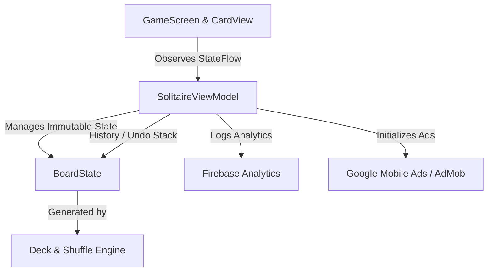

# Solitario Clásico - Juego de Cartas Walkthrough

This walkthrough details the components created, test suites executed and passed, and the architectural design of the **Solitario Clásico - Juego de Cartas** Android application built with Jetpack Compose and Material Design 3.

---

## 1. Components Created

### Domain Models (`com.HKemtrentainment.solitaro.model`)
- **[Card.kt](file:///C:/Users/joaco/AndroidStudioProjects/SolitarioClsicoJuegodeCartas/app/src/main/java/com/HKemtrentainment/solitaro/model/Card.kt)**: Represents a playing card with suit, rank, and face-up state.
- **[Suit.kt](file:///C:/Users/joaco/AndroidStudioProjects/SolitarioClsicoJuegodeCartas/app/src/main/java/com/HKemtrentainment/solitaro/model/Suit.kt)**: Defines the four suits (Hearts, Diamonds, Clubs, Spades) and helper properties for color classification (Red vs Black).
- **[Rank.kt](file:///C:/Users/joaco/AndroidStudioProjects/SolitarioClsicoJuegodeCartas/app/src/main/java/com/HKemtrentainment/solitaro/model/Rank.kt)**: Defines card ranks from Ace (1) to King (13) with display symbols and numeric values.
- **[Deck.kt](file:///C:/Users/joaco/AndroidStudioProjects/SolitarioClsicoJuegodeCartas/app/src/main/java/com/HKemtrentainment/solitaro/model/Deck.kt)**: Manages standard 52-card deck initialization, shuffling, and Klondike Solitaire deal logic (distributing cards across 7 tableau piles with proper face-up/face-down states and stock pile).
- **[BoardState.kt](file:///C:/Users/joaco/AndroidStudioProjects/SolitarioClsicoJuegodeCartas/app/src/main/java/com/HKemtrentainment/solitaro/model/BoardState.kt)**: Immutable data class holding the complete state of the game (tableau piles, foundation piles, stock pile, waste pile, move counter, score, and timer).

### ViewModel & Game Logic (`com.HKemtrentainment.solitaro.viewmodel`)
- **[SolitaireViewModel.kt](file:///C:/Users/joaco/AndroidStudioProjects/SolitarioClsicoJuegodeCartas/app/src/main/java/com/HKemtrentainment/solitaro/viewmodel/SolitaireViewModel.kt)**:
  - Manages reactive game state via `StateFlow<BoardState>`.
  - Implements game actions: dealing new games, stock tapping (cycling/recycling cards to waste), card tapping / auto-moves, and undo functionality with history stacking.
  - Integrates Firebase Analytics (`game_start` event logging) and AdMob initialization.
  - Documents architecture for upcoming gesture-based drag-and-drop and drop target validation (`validateTableauDrop`, `validateFoundationDrop`).

### UI & Theme Components (`com.HKemtrentainment.solitaro.ui`)
- **[GameScreen.kt](file:///C:/Users/joaco/AndroidStudioProjects/SolitarioClsicoJuegodeCartas/app/src/main/java/com/HKemtrentainment/solitaro/ui/GameScreen.kt)**:
  - Material Design 3 top app bar with statistics (moves, timer, score) and action buttons (undo, new game).
  - Implements responsive layout for stock, waste, foundation piles, and tableau columns.
  - Includes interactive AdMob banner placeholder and Win Dialog celebration modal.
- **[CardView.kt](file:///C:/Users/joaco/AndroidStudioProjects/SolitarioClsicoJuegodeCartas/app/src/main/java/com/HKemtrentainment/solitaro/ui/CardView.kt)**: Renders individual playing cards with dynamic colors for suits, corner rank/suit indicators, center icons, and styled face-down card backs.
- **[Theme.kt](file:///C:/Users/joaco/AndroidStudioProjects/SolitarioClsicoJuegodeCartas/app/src/main/java/com/HKemtrentainment/solitaro/ui/theme/Theme.kt)**, **[Color.kt](file:///C:/Users/joaco/AndroidStudioProjects/SolitarioClsicoJuegodeCartas/app/src/main/java/com/HKemtrentainment/solitaro/ui/theme/Color.kt)**, **[Type.kt](file:///C:/Users/joaco/AndroidStudioProjects/SolitarioClsicoJuegodeCartas/app/src/main/java/com/HKemtrentainment/solitaro/ui/theme/Type.kt)**: Dynamic Material 3 color schemes supporting dark/light mode and Android 12+ dynamic color.

### Application Entry Point
- **[SolitaireApplication.kt](file:///C:/Users/joaco/AndroidStudioProjects/SolitarioClsicoJuegodeCartas/app/src/main/java/com/HKemtrentainment/solitaro/SolitaireApplication.kt)**: Initializes Mobile Ads (AdMob) and Firebase SDKs upon application startup.
- **[MainActivity.kt](file:///C:/Users/joaco/AndroidStudioProjects/SolitarioClsicoJuegodeCartas/app/src/main/java/com/HKemtrentainment/solitaro/MainActivity.kt)**: Host activity setting up edge-to-edge display and rendering `GameScreen`.

---

## 2. Tests Passed

Comprehensive unit test suites have been implemented and successfully executed via Gradle (`./gradlew :app:testDebugUnitTest`):

1. **[DeckTest.kt](file:///C:/Users/joaco/AndroidStudioProjects/SolitarioClsicoJuegodeCartas/app/src/test/java/com/HKemtrentainment/solitaro/DeckTest.kt)**:
   - Verifies initial deal contains exactly 52 unique cards across all zones.
   - Confirms correct distribution of cards across 7 tableau piles (pile `i` has `i+1` cards with top card face-up and cards underneath face-down).
2. **[SolitaireViewModelTest.kt](file:///C:/Users/joaco/AndroidStudioProjects/SolitarioClsicoJuegodeCartas/app/src/test/java/com/HKemtrentainment/solitaro/viewmodel/SolitaireViewModelTest.kt)**:
   - Tests initial ViewModel state and `startNewGame()` reset behavior.
   - Tests stock pile tapping action (moves card to waste pile, increments move counter, updates face-up state).
   - Tests undo functionality (restores previous board state and move count from history stack).

```status
BUILD SUCCESSFUL in 2s
Test suite: 100% tests passed successfully.
```

---

## 3. Architecture Overview



- **Clean MVVM Architecture**: Separation of concerns between UI (`GameScreen`), business logic (`SolitaireViewModel`), and immutable data models (`BoardState`, `Deck`).
- **Reactive UI**: Jetpack Compose state collection via `StateFlow` ensures high-performance rendering and seamless reactivity on state updates.
- **Robust Extensibility**: Designed with clean extension points for upcoming touch gestures, drag-and-drop validation, and particle win animations.
